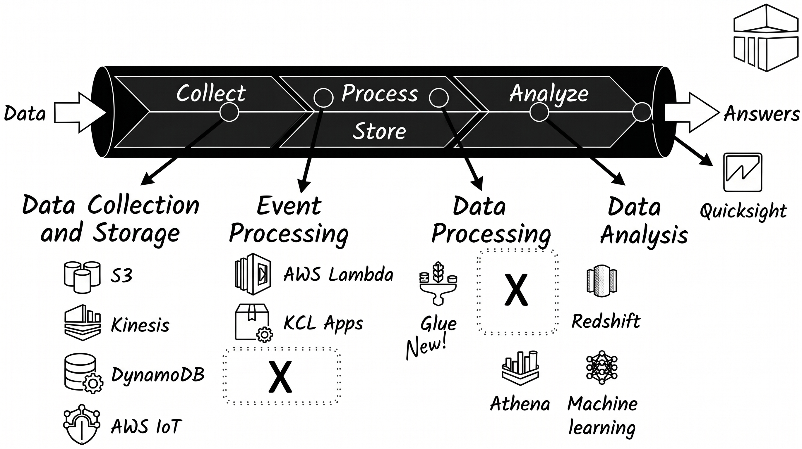

<!--
SPDX-FileCopyrightText: 2026 Colaboradores de apuntes-muicd-uned

SPDX-License-Identifier: CC-BY-4.0
-->

# 2022J2

La prueba incluye 20 ítems de opción múltiple. La puntuación suma 0,5 puntos por respuesta válida y resta 0,2 por respuesta errónea. Dispone de 120 minutos para completarla.
Si tiene alguna consideración adicional sobre el planteamiento de una pregunta, indíquelo detalladamente en el reverso de la hoja o en un pliego anexo.

## Pregunta 1

### Enunciado 1

Respecto a la arquitectura de YARN y los elementos que la componen, analice las siguientes afirmaciones:

I. Existe un único proceso ResourceManager por clúster.
II. Se instancia un proceso NodeManager de forma exclusiva por cada aplicación.

a. I. Correcta. II. Correcta.
b. I. Correcta. II. Falsa.
c. I. Falsa. II. Correcta.
d. I. Falsa. II. Falsa.

### Solución 1

b

ResourceManager es uno por clúster, pero NodeManager es uno por nodo, no por aplicación.

## Pregunta 2

### Enunciado 2

Ante la caída o desconexión abrupta de un DataNode dentro de una infraestructura HDFS...
I. Se produce una pérdida irrecuperable de los datos que se alojaban en ese nodo.
II. La plataforma completa interrumpe su servicio y deja de operar.

a. I. Correcta. II. Correcta.
b. I. Correcta. II. Falsa.
c. I. Falsa. II. Correcta.
d. I. Falsa. II. Falsa.

### Solución 2

d

HDFS tiene replicación de datos y alta disponibilidad, por lo que ni se pierden los datos ni el sistema deja de funcionar.

## Pregunta 3

### Enunciado 3

¿Cuál es la función principal que asume el NameNode dentro del ecosistema HDFS?

a. Custodiar los bloques de datos reales que conforman los ficheros del clúster.
b. Mantener el registro y la jerarquía de metadatos de los ficheros alojados en el clúster.
c. Carece de mecanismos de alta disponibilidad, provocando el colapso de todo el clúster en caso de fallo.
d. Ninguna de las restantes.

### Solución 3

b

Almacena los metadatos de los archivos almacenados en el cluster HDFS.

## Pregunta 4

### Enunciado 4

Dada la topología de red de un clúster, considerando un servidor `nodoA` situado en el rack `rackX` del centro de datos `dcAlpha` (representado mediante la ruta `/dcAlpha/rackX/nodoA`). Señale la afirmación correcta respecto al cálculo de distancias:

a. `distancia(/dcAlpha/rackX/nodoA, /dcAlpha/rackX/nodoA) = 1`.
b. `distancia(/dcAlpha/rackX/nodoA, /dcAlpha/rackX/nodoB) = 4`.
c. `distancia(/dcAlpha/rackX/nodoA, /dcBeta/rackY/nodoC) = 6`.
d. Ninguna de las restantes.

### Solución 4

c

La distancia a sí mismo es 0, a otro nodo en el mismo rack es 2, a distinto rack en el mismo centro de datos es 4, y a distinto centro de datos es 6.

## Pregunta 5

### Enunciado 5

Para inspeccionar por consola las últimas líneas de un documento alojado en el sistema de archivos distribuido (HDFS), se debe emplear el comando:

a. `hdfs dfs -tail documento`
b. `hadoop -fs -endoffile documento`
c. `hdfs -fs showendoffile documento`
d. Ninguna de las restantes.

### Solución 5

a

## Pregunta 6

### Enunciado 6

Suponga un archivo de texto con un registro masivo de vehículos (coche, coche, moto, camión, moto, coche...) que procesamos mediante MapReduce para un conteo de frecuencias. El nodo reducer encargado de procesar la clave mayoritaria ("coche") sufrirá un cuello de botella respecto al de claves minoritarias (como "camión"). ¿Qué técnica permite mitigar este desbalance de carga desde la fase de mapeo?

    a. Implementando un combiner.
    b. Utilizando un patrón de diseño.
    c. Implementando un particionador.
    d. Ninguna de las restantes.

### Solución 6

a

El combiner actúa como un "mini-reducer" local en el nodo de mapeo, pre-agregando los datos antes de enviarlos por la red, lo que reduce la carga del nodo reducer que procese la clave mayoritaria.

## Pregunta 7

### Enunciado 7

Considere la ejecución de la siguiente sentencia en un entorno Hive:
    
  `create database facturacion;`
    
  Evalúe las siguientes premisas sobre dicha instrucción:
  I. Establece comunicación e interactúa con el Metastore DB.
  II. Desencadena la ejecución de un trabajo MapReduce subyacente.
    
    a. I. Correcta. II. Correcta.
    b. I. Correcta. II. Falsa.
    c. I. Falsa. II. Correcta.
    d. I. Falsa. II. Falsa.

### Solución 7

b

La creación de una base de datos interactúa con el Metastore para guardar los metadatos, pero no requiere la ejecución de un trabajo MapReduce

## Pregunta 8

### Enunciado 8

Analice el siguiente fragmento de un script de Pig Latin. Sobre la inferencia de tipos, indique la premisa verdadera:
    
   ```pig
   transacciones = load 'registro_ventas';
   calculos = foreach transacciones generate $7 / 1000,
   $3 * 100.0, SUBSTRING($0, 0, 1), $6 - $3;
   ```

 a. 1000 es `integer`, así que `$7` también.
 b. 100.0 es `double`, así que `$3` también.
 c. `SUBSTRING` indica que `$0` es `chararray`.
 d. Todas las restantes.

### Solución 8

d

Pig infiere implícitamente los tipos de datos en función de las operaciones aplicadas: 1000 fuerza un entero, 100.0 fuerza un double, y SUBSTRING requiere una cadena de caracteres.
Pregunta 9
Enunciado 9

    ¿Cómo se conceptualiza de forma elemental la abstracción DStream dentro de Spark Streaming?

    a. Flujo continuo de RDDs.
    b. Flujo continuo de Dataframes.
    c. Flujo continuo de Datasets.
    d. Ninguna de las restantes.

### Solución 9

a

## Pregunta 10

### Enunciado 10

    En el contexto del diseño de aplicaciones analíticas y de aprendizaje automático con Apache Spark, ¿qué enfoque o paradigma de programación predomina?

    a. Map/Reduce.
    b. Exclusivamente Map.
    c. Generalista, sin paradigma específico.
    d. No soporta el desarrollo de aplicaciones.

### Solución 10

c

## Pregunta 11

### Enunciado 11

11. Seleccione el concepto que no forma parte del vocabulario oficial habitualmente utilizado en el framework Apache Spark:
    a. DataFrame.
    b. Partition.
    c. Dataset.
    d. Datastream.

### Solución 11

d

El término correcto para un datastream en el núcleo de Spark Streaming es DStream, que significa Discretized Stream

## Pregunta 12

### Enunciado 12

12. Cuando se invoca el método `cache()` sobre un RDD sin especificar parámetros, ¿qué política de persistencia se aplica por defecto?
    a. `MEMORY_ONLY`.
    b. `MEMORY_AND_DISK`.
    c. `DISK_ONLY`.
    d. `MEMORY_ONLY_SER`.

### Solución 12

a

## Pregunta 13

### Enunciado 13

13. En arquitecturas de procesamiento de flujos de datos (streaming), ¿qué modelo de garantía de entrega proporciona el menor retardo (latencia)?
    a. Exactly-once.
    b. At-least-once.
    c. At-most-once.
    d. Ninguna de las anteriores.

### Solución 13

c

At-most-once. (Al no requerir confirmación de recepción ni reintentos, es la semántica que ofrece la latencia más baja)

## Pregunta 14

### Enunciado 14

14. De las alternativas listadas a continuación, ¿cuál NO es un componente, módulo o librería integrada dentro del ecosistema de Apache Spark?
    a. Mlib.
    b. GrapFrames.
    c. Scoop.
    d. Optimizador Catalyst.

### Solución 14

c

Scoop. (Sqoop es una herramienta independiente del ecosistema Hadoop para transferir datos con bases de datos relacionales, no forma parte del núcleo o librerías de Spark).

## Pregunta 15

### Enunciado 15

15. Se requiere construir un panel de monitorización que calcule el promedio de usuarios activos en una plataforma online durante los últimos 60 segundos, refrescando el resultado cada segundo. Evaluando las técnicas de streaming, ¿qué tipo de enventanado resulta más adecuado y óptimo para este caso de uso?

    a. Processing-time windowing, con ventanas fijas.
    b. Processing-time windowing, con ventanas deslizantes.
    c. Processing-time windowing, con sesiones.
    d. Event-time windowing.

### Solución 15

b

Processing-time windowing, con ventanas deslizantes. (Permite calcular métricas sobre una ventana de tiempo fija de un minuto que se desplaza o actualiza cada segundo).

## Pregunta 16

### Enunciado 16

16. Dentro de la API de Spark Streaming, ¿qué método de ingesta permite generar un flujo a partir de una sucesión de RDDs, donde cada uno de ellos es procesado de manera individual como un micro-lote?

    a. socketTextStream().
    b. fileStream().
    c. queueStream().
    d. Ninguna de las restantes.
 
### Solución 16

c

Permite crear un flujo de datos a partir de una cola de RDDs, tratando cada RDD insertado en la cola como un micro-batch

## Pregunta 17

### Enunciado 17
    
17. Al ejecutar la siguiente instrucción en la consola de administración de Kafka:

    ```sh
    $> bin/kafka-topics.sh --describe --bootstrap-server localhost:9092 --topic topic-test
    ```

    se obtiene el siguiente reporte:
    
    ```text
    Topic:topic-test PartitionCount:1 ReplicationFactor:3 Configs:
    Topic: topic-test Partition: 0 Leader: 1 Replicas: 1,2,0 Isr: 1,2,0
    ```

    ¿Cómo debe interpretarse dicha información?
    
        a. El topic "topic-test" está almacenado en 1 partición gestionada por 3 brokers, de los cuáles el nodo 1 es responsable de lecturas y escrituras, y los nodos 0 y 2 son réplicas.
        b. El topic "topic-test" está almacenado en 3 particiones gestionada por 1 broker, que tiene ID = 1.
        c. El topic "topic-test" está almacenado en 1 partición gestionada por 1 broker, con ID = 1.
        d. El topic "topic-test" está almacenado en 1 partición gestionada por 3 brokers, de los cuáles no se conoce cuál es el responsable de lecturas y escrituras hasta que se asigne.

### Solución 17

a

El topic "topic-test" está almacenado en 1 partición gestionada por 3 brokers, de los cuáles el nodo 1 es responsable de lecturas y escrituras, y los nodos 0 y 2 son réplicas.

## Pregunta 18

### Enunciado 18

18. Observando el siguiente diagrama, que agrupa diversas herramientas del ecosistema cloud de AWS según su rol arquitectónico, ¿qué tecnología específica encajaría en la caja etiquetada como "X"?



    a. Amazon ELK.
    b. EMR.
    c. Dataproc.
    d. Dos o más son ciertas o todas son falsas
 
### Solución 18

b

En el diagrama de arquitectura de referencia de AWS proporcionado, el bloque de procesamiento de datos central que acompaña a Glue, Athena, Redshift y Machine Learning corresponde a Amazon EMR)

## Pregunta 19

### Enunciado 19
    
19. Evalúe la veracidad de las siguientes correspondencias entre servicios cloud de distintos proveedores:
    I. En Google Cloud Platform (GCP), la alternativa directa a Amazon S3 recibe el nombre de Google Dataproc.
    II. En GCP, el servicio homólogo a Amazon Kinesis para flujos de datos es Google Pub/Sub.

        a. I. Correcta; II. Correcta.
        b. I. Correcta; II. Falsa.
        c. I. Falsa; II. Correcta.
        d. I. Falsa; II. Falsa.

### Solución 19

c

El equivalente a S3 en GCP es Google Cloud Storage, no Dataproc; el equivalente a Kinesis para mensajería y streaming de eventos es Google Cloud Pub/Sub.

## Pregunta 20

### Enunciado 20

20. Dentro de la oferta de Microsoft Azure, ¿cuál de los siguientes servicios está diseñado para ejecutar análisis y procesamiento de flujos de telemetría en tiempo real, muy utilizado en escenarios de Internet de las Cosas (IoT)?

    a. Azure HDInsight.
    b. Azure IoT Analytics.
    c. Azure Real-time Insights.
    d. Azure Stream Analytics.
    
### Solución 20

d
