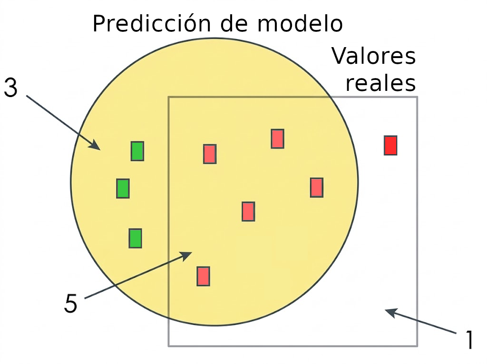

<!--
SPDX-FileCopyrightText: 2026 Colaboradores de apuntes-muicd-uned

SPDX-License-Identifier: CC-BY-4.0
-->

# Tema 1: Introducción PLN

::: {.callout-note collapse="true"}
## 📖Material asociado
* Básico
  * [@nlp_tema1_pres]
* Complementario
  * [@jurafsky2009speech2]. Apartado 2.6 "Regular Expressions" (Regular Expressions), apartados 2.7 "Simple Unix Tools for Word Tokenization" y 2.8 "Rule-based tokenization" (Text Normalization), apartado 2.9 "Minimum Edit Distance" (Edit Distance), capítulo 17 "Sequence Labelling for parts of Speech and Named Entities", apartado 18.5 "Ambiguity" y 18.6 "CKY Parsing: A Dynamic Programming Approach" (Syntactic Parsing) y apartado 9.3.1 "Contextual Embeddings and Word Sense" y 22.4.3 "Other Methods" (Word Senses and Wordnet)
  * [@jurafsky2026speech3] Tema 2. Apartado 2.1. "Regular Expressions" (Regular Expressions), apartado 4.1 "Word counting in Corpora" (Text Normalization), apartado 3.11 "Minimum Edit Distance" (Edit Distance), capítulo 19 "Lexical Semantics" (Word Senses and Wordnet).
  * [@bird_nltk_book]. Capítulo 2 "[Accessing Text Corpora and Lexical Resources](https://www.nltk.org/book/ch02.html)", capítulo 3 "[Processing Raw Text](https://www.nltk.org/book/ch03.html)", capítulo 5 "[Categorizing and Tagging Words](https://www.nltk.org/book/ch05.html)", capítulo 7 "[Extracting Information from Text](https://www.nltk.org/book/ch07.html)" y capítulo 8 "[Analyzing Sentence Structure](https://www.nltk.org/book/ch08.html)".
  * [@bird2009natural] Capítulo 2 "Accessing Text Corpora and Lexical Resources", capítulo 3 "Processing Raw Text", capítulo 5 "Categorizing and Tagging Words", capítulo 7 "Extracting Information from Text" y capítulo 8 "Analyzing Sentence Structure".
:::

Este capítulo está organizado empleando la misma estructura que la presentación del @nlp_tema1_pres.

## Conceptos preliminares

La **minería de textos** es el proceso de extraer patrones útiles, información estructurada y conocimientos a partir de datos de texto no estructurados.

Existen diversas tareas o **áreas asociadas a la minería de textos**:

- Extracción de la información
- Recuperación de la información
- Categorización de documentos
- Agrupamiento de documentos

La tarea de **extracción de la información** supone extraer información extructurada a partir de textos. Incluye las subtareas de [reconocimiento de nombre de entidades](2.qmd#reconocimiento-de-entidades), la extracción de terminología y de relaciones. El [tema 2](2.qmd) está dedicado a esta tarea.

La **recuperación de la información** (*information retrieval*)...

La **categorización de documentos**...

El **agrupamiento de documentos** (*document clustering*)...

## Procesamiento del lenguaje natural

El **procesamiento de lenguaje natural** (**PLN**) es la disciplina de la inteligencia artificial que se encarga de que las máquinas entiendan, interpreten y generen el lenguaje humano

## Evaluación de tareas de PLN

En este apartado se introducen los conceptos de corpus y campaña de evaluación.

### Corpus {.unnumbered .unlisted}

Una **colección** o **corpus** es un conjunto de documentos o textos en formato electrónico.

La existencia de corpus comunes permite comparar la eficacia de modelos y sistemas.

#### Ejemplos de corpus {.unnumbered .unlisted}

::: {.callout-note collapse="false"}
## 🎯Pregunta de exámen

[2020F2.3](../exam/2020f2/2020f2.md#3)
:::

Ejemplos de corpus:

- Corpus de Brown
- Corpus de Susanne
- Corpus ADE
- Corpus Bioscope.
- Corpus DDI
- Corpus Europarl
- Corpus DIANN

A cada uno de estos corpus se le dedica una diapositiva en la presentación del @nlp_tema1_pres.

La web de la [biblioteca NLTK](#ntlk) incluye un [listado de corpus](http://www.nltk.org/nltk_data/).

##### Corpus de Brown {.unnumbered .unlisted #corpus-de-brown}

::: {.callout-note collapse="true"}
## 📖Material asociado
* Básico
  * [@nlp_tema1_pres]. Apartado "Evaluación de tareas de PLN", ejemplo de corpus "Corpus Brown". 
* Complementario
  * [Listado de corpus de NLTK](http://www.nltk.org/nltk_data/).
:::

Está compuesto más de 1.000.000 de palabras por ficheros de 15 temáticas.

Emplea 87 etiquetas de palabras distintas, de las que las primeras son:

- `/at`: artículo
- `/be`: verbo *to be* en infinitivo e imperativo
- `/cc`: conjunción copulativa.
- `/dt`: determinante.

Extracto de texto de ejemplo:

```text
The/at Mayor/nn-tl spoke/vbd yesterday/nr at/in the/at United/vbn-tl Irish/jj-tl Counties/nns-tl Feis/np-tl on/in the/at Hunter/np-tl College/nn-tl Campus/nn-tl in/in the/at Bronx/np ./.
```

[Descarga de fichero de corpus](https://raw.githubusercontent.com/nltk/nltk_data/gh-pages/packages/corpora/brown.zip)

##### Corpus de Susanne {.unnumbered .unlisted #corpus-de-brown}

##### Corpus ADE {.unnumbered .unlisted #corpus-de-brown}

##### Corpus Bioscope {.unnumbered .unlisted #corpus-de-brown}

##### Corpus DDI {.unnumbered .unlisted #corpus-de-brown}

##### Corpus Europarl {.unnumbered .unlisted #corpus-de-brown}

##### Corpus DIANN {.unnumbered .unlisted #corpus-de-brown}

### Campaña de evaluación {.unnumbered .unlisted}

::: {.callout-note collapse="false"}
## 🎯Pregunta de exámen

[2024F2.1](../exam/2024f2/2024f2.md#1)
:::

Una **campaña de evaluación** es...

### Medidas

::: {.callout-note collapse="false"}
## 🎯Pregunta de exámen

[2020F2.2](../exam/2020f2/2020f2.md#2), [2026SO.2](../exam/2026so/2026so.md#2)
:::

El temario introduce las siguientes medidas de evaluación de tareas de PLN:

- Precisión 
- Cobertura
- Medida-F
- Medida-Fbeta

En la asignatura también se trata la medida de exactitud, aunque esta no se introduce hasta el apartado "[POS tagging](#pos-tagging)".

#### Exactitud {.unnumbered .unlisted}

#### Precisión {.unnumbered .unlisted}

La **precisión** (en inglés, *precision*) es la fracción de predicciones del modelo propuesto que son acertadas (coinciden con los datos de referencia). Se calcula como:

$$ p = \frac{tp}{tp + fp} $$

donde:

* $tp$ son los **verdaderos positivos** (en inglés, *true positives*), es decir, los casos que el modelo predijo correctamente como positivos.
* $fp$ son los **falsos positivos** (en inglés, *false positives*), es decir, los casos que el modelo predijo como positivos pero que en realidad son negativos.

Su utilidad es...

#### Cobertura {.unnumbered .unlisted}

La **cobertura** o **exhaustividad** (en inglés, *recall*) es la fracción de los datos de referencia que han sido propuestas y extraídas correctamente por el modelo evaluado. Se calcula como:

$$ r = \frac{tp}{tp + fn} $$

donde:

* $tp$ son los **verdaderos positivos** (en inglés, *true positives*), es decir, los casos que el modelo predijo correctamente como positivos.
* $fn$ son los **falsos negativos** (en inglés, *false negatives*), es decir, los casos que el modelo predijo como negativos pero que en realidad son positivos.

Su utilidad es...

#### Medida-F {.unnumbered .unlisted}

La **medida-F** es la media armónica de precisión y cobertura, empleada cuando ambas métricas se ponderan por igual. Se calcula como:

$$ F = \frac{2 \cdot p \cdot r}{p + r} $$

donde:

* $p$ es la precisión (en inglés, *accuracy*).
* $r$ es la cobertura (en inglés, *recall*).

Su utilidad es...

#### Medida-Fbeta {.unnumbered .unlisted}

La **medida-Fbeta** es una forma general de la media armónica que utiliza el parámetro $\beta$. 

$$ F_\beta = \frac{(1 + \beta^2) \cdot p \cdot r}{(\beta^2 \cdot p) + r} $$

donde:

* $\beta$ es un parámetro que permite ponderar la importancia relativa de la precisión y la cobertura. Cuando $\beta = 1$, la medida-Fbeta se convierte en la medida-F, que pondera por igual precisión y cobertura. Cuando $\beta > 1$, se da más importancia a la cobertura, mientras que cuando $\beta < 1$, se da más importancia a la precisión.

Su utilidad es 

#### Ejemplo de cálculo de medidas {.unnumbered .unlisted #ejemplo-de-calculo-de-medidas}

Pongamos que se desarrolla un modelo que evalúa si un reseña es negativa o no. Después de aplicar el modelo sobre un conjunto de datos de prueba etiquetados, se obtienen los siguientes resultados:

* $tp = 5$
* $fp = 3$
* $fn = 1$



En la figura no están representados los verdaderos negativos ($tn$) ya que no se utilizan para calcular las medidas de evaluación, pero estos serían aquellos valores que quedan fuera tanto de la detección del modelo como del conjunto de datos etiquetados como reseña negativa.

Se calculan las medidas de evaluación:

$$ p = \frac{5}{5 + 3} = \frac{5}{8} = 0.625 $$

$$ r = \frac{5}{5 + 1} = \frac{5}{6} \approx 0.833 $$

$$ f = \frac{2 \cdot 0.625 \cdot 0.833}{0.625 + 0.833} = \frac{1.041}{1.458} \approx 0.714 $$

<!--
En un caso de filtrado de spam, es más importante recibir correos importantes a coste de recibir algún correo spam (falsos negativos) que bloquear más correo spam a coste de bloquear algún correo importante (falsos positivos). Por tanto, para este caso se da más importancia a la precisión que a la cobertura, y por ello se escoge un valor $\beta$ por debajo de 1 a hora de calcular la medida-Fbeta, concretamente con valor $\beta = 0.5$.

$$ f_\beta = \frac{(1 + 0.5^2) \cdot 0.625 \cdot 0.833}{(0.5^2 \cdot 0.625) + 0.833} = \frac{(1 + 0.25) \cdot 0.625 \cdot 0.833}{(0.25 \cdot 0.625) + 0.833} = \frac{1.25 \cdot 0.625 \cdot 0.833}{0.15625 + 0.833} = \frac{0.6515625}{0.98925} \approx 0.658 $$
-->

En un caso de identificación de reseñas negativas, es más importante identificar todas las reseñas negativas a coste de tener que revisar alguna positiva (falsos positivos) que ahorrarse el revisar algunas reseñas positivas a coste de perderse reseñas negativas (falsos negativos). Por tanto, para este caso se da más importancia a la precisión que a la cobertura, y por ello se escoge un valor $\beta$ por encima de 1 a hora de calcular la medida-Fbeta, concretamente con valor $\beta = 1.5$.

$$ f_\beta = \frac{(1 + 1.5^2) \cdot 0.625 \cdot 0.833}{(1.5^2 \cdot 0.625) + 0.833} = \frac{(1 + 2.25) \cdot 0.625 \cdot 0.833}{(2.25 \cdot 0.625) + 0.833} = \frac{3.25 \cdot 0.625 \cdot 0.833}{1.40625 + 0.833} = \frac{1.69015625}{2.23925} \approx 0.755 $$

## Baseline

Un **baseline** es una solución básica de referencia aplicada a una tarea que se emplea para evaluar sin un modelo más complejo aporta algún tipo de mejora.

## Análisis de errores

En el contexto del PLN, el **análisis de errores** es el proceso de examinar y estudiar los errores que comete un modelo o sistema para identificar sus causas y encontrar formas de mejorar su rendimiento.

Posibles uso del análisis de errores:

- Detectar errores en los programas
- Encontrar problemas en los datos
- Mejorar los modelos
- Desarrollar nuevas soluciones

### Matriz de confusión {.unnumbered .unlisted}

::: {.callout-note collapse="false"}
## 🎯Pregunta de exámen

[2024F2.3](../exam/2024f2/2024f2.md#3), [2026SO.5](../exam/2026so/2026so.md#5)
:::

Una **matriz de confusión** o **tabla de contigencia** es una tabla que permite evaluar el rendimiento de un modelo de clasificación. Para un problema con $N$ clases, se representa mediante una matriz de dimensiones $N \times N$, en la que cada celda $(x,y)$ indica cuántos elementos cuya clase real es $x$ han sido clasificados por el modelo como pertenecientes a la clase $y$.

La matriz de confusión puede mostrar valores absolutos o porcentajes. Se emplea habitualmente el análisis de errores.

Se aplica a continuación la matriz de confusión para el [ejemplo presentado de cálculo de medidas](#ejemplo-de-calculo-de-medidas):
 

|                |                  | Valor real       |                 |
|:---------------|:-----------------|:-----------------|:----------------|
|                |                  | **Positivo (+)** | **Negativo (-)**|
| Predicción     | **Positivo (+)** | tp = 10          | fp = 4          |
|                | **Negativo (-)** | fn = 2           | tn = X          |


<!--
Esta GridTable no compila en PDF, probablemente por el primer hueco vacío
+---------------------------+--------------------------------+
|                           |          Valor real            |
|                           +----------------+---------------+
|                           |  Positivo (+)  | Negativo (-)  |
+============+==============+================+===============+
| Predicción | Positivo (+) | tp = 10        | fp = 4        |
|            +--------------+----------------+---------------+
|            | Negativo (-) | fn = 2         | tn = X        |
+------------+--------------+----------------+---------------+
-->

<!-- Hay otro ejemplo de clasificación multiclase en la diapositiva, que conviene añadir porque traspone los valores correctos a la izquierda y los valores predichos a la derecha -->

## Herramientas

Las principales herramientas para el PLN son:

- NLTK
- spaCy
- Stanford
- Treetager
- Freeling

Solo las dos primeras, ambas basadas en el lenguaje Python, se tratan en la asignatura

::: {.callout-tip collapse="false"}
## Consejo de estudio

No se pide usar las herramientas para contestar a preguntas del exámen, pero sí para completar las prácticas de la asignatura. Se recomienda por tanto centrar el estudio en aquella/s herramienta/s que se pida emplear en el enunciado de las prácticas.

En las prácticas del curso 2026/2027 solo se pidió trabajar con spaCy.
:::

### NTLK

**Natural Language Toolkit** (**NLTK**) es una biblioteca Python de código abierto para el PLN empleada principalmente con fines educativos.

Los creadores de NLTK escribieron el libro de @bird2009natural, dedicado a la versión Python 2, y lo actualizaron a Python 3 en la versión web de @bird_nltk_book.

[Página oficial de NLTK](https://www.nltk.org/)

### spaCy

**spaCy** es una biblioteca Python de código abierto para el PLN empleada con fines productivos y educativos.

[Página oficial de spaCy](https://spacy.io/)

## Introducción al procesamiento del lenguaje natural

<!-- Probablemente la intención en la presentación era que este apartado englobe a los siguientes, pero al llamarse igual que el tema no se le mucho sentido a hacerlo en estos apuntes. -->

En este apartado nada más se mencionan, sin definirse, algunos conceptos que estudian en otros apartados del tema:

- Preprocesador de textos: [normalización](#normalizacion-de-textos), [expresiones regulares](#expresiones-regulares-introduccion-pln), [distancia de edición](#distancia-de-edicion)
- [POS tagging](#pos-tagging)
- [Stemming](#stemming)
- [Chunking](#chunking)
- Parsing
- [Desambiguación del sentido de las palabras](#desambiguacion-del-sentido-de-las-palabras)

## Expresiones regulares (introducción PLN) {#expresiones-regulares-introduccion-pln}

Las expresiones regulares son apenas introducidas en este tema, pero se tratan con más extensión en el [apartado homónimo en el tema 2](2.qmd#expresiones-regulares-reconocimiento-de-entidades). En estos apuntes se posterga la explicación de este concepto a ese tema.

## Normalización de textos {#normalizacion-de-textos}

::: {.callout-note collapse="false"}
## 🎯Pregunta de exámen
[2023F2.1](../exam/2023f2/2023f2.md#1)
:::

La **normalización de textos** (en inglés, *text normalization*) es un proceso de transformación del texto para obtener una forma canónica. Su objetivo es uniformizar la forma del texto para facilitar su uso en procesos posteriores del procesamiento del lenguaje natural.

Su objetivo es uniformizar la forma del texto para facilitar su uso en procesos posteriores del procesamiento del lenguaje natural.

Las **tareas asociadas a la normalización de textos** incluyen:

- [Normalización de la forma de las palabras](#normalizacion-de-palabras)
- Segmentación o [tokenización de oraciones](#tokenizacion-de-oraciones)
- Segmentación o [tokenización de palabras](#tokenizacion-de-palabras)

Ejemplos de normalización de textos:
* Unificar palabras que se refieren a una misma entidad (por ejemplo, "inteligencia artificial" e "IA" o "Telefono" y "teléfono").
* Corregir erratas de escritura.
* Eliminar acentos, quitar espacios repetidos o reducir todas las palabras a letras minúsculas.

### Normalización de palabras {#normalizacion-de-palabras}

La **normalización de palabras** (en inglés, *word normalization*) es...

### Tokenización de oraciones {.unnumbered .unlisted #tokenizacion-de-oraciones}

::: {.callout-note collapse="false"}
## 📖Material asociado
* [@nlp_tema1_pres]. Apartado "Tokenización de palabras".
* [@jurafsky2026speech3] Apartado 2.8.1 "Sentence segmentation".
:::

La **tokenización de oraciones** (en inglés, *sentence tokenization*) o **segmentación de oraciones** (en inglés, *sentence segmentation*) es...

### Tokenización de palabras {.unnumbered .unlisted #tokenizacion-de-palabras}

::: {.callout-note collapse="false"}
## 📖Material asociado
* [@nlp_tema1_pres]. Apartado "Tokenización de palabras".
* [@jurafsky2009speech2]. Apartados 2.4 "Subword Tokenization: Byte-Pair Encoding", 2.7 "Simple Unix Tools for Word Tokenization" y 2.8 "Rule-based tokenization" (Text Normalization).
* [@jurafsky2026speech3] Apartado 4.1 "Word counting in Corpora" (Text Normalization).
:::

La **tokenización de palabras** o **segmentación de palabras** es...

## Distancia de edición {#distancia-de-edicion}

::: {.callout-note collapse="false"}
## 📖Material asociado
* [@nlp_tema1_pres]. Apartado "Distancia de edición".
* [@jurafsky2026speech3] Apartado 3.11 "Minimum Edit Distance" (Edit Distance).
* [@jurafsky2009speech2]. Apartado 2.9 "Minimum Edit Distance" (Edit Distance).
:::

::: {.callout-note collapse="false"}
## 🎯Pregunta de exámen
[2025F2.2](../exam/2025f2/2025f2.md#2), [2026SO.3](../exam/2026so/2026so.md#3)
:::

La **distancia de edición** (en inglés, *edit distance*)...

::: {.callout-note collapse="false"}
## 🎯Pregunta de exámen

[2020F2.1](../exam/2020f2/2020f2.md#1), [2020FR.1](../exam/2020fr/2020fr.md#1)
:::

## Palabras vacías

::: {.callout-note collapse="false"}
## 🎯Pregunta de exámen

[2022SO.2](../exam/2022so/2022so.md#2)
:::

### spaCy: palabras vacías

## Segmentación de palabras

## Segmentación (tokenización) de oraciones

##  Análisis morfológico

::: {.callout-note collapse="true"}
## 📖Material asociado
* Básico
  * [@nlp_tema1_pres]. Apartado "Análisis morfológico".
* Complementario
  * [@jurafsky2009speech2]. Introducción del capítulo 19 "Lexical Semantics".
  * [@jurafsky2026speech3]. Apartado 5.1 "Lexical Semantics".
:::

El **lema** (en inglés, *lemma*), **forma canónica** o **forma base** de una palabra es la raíz (en inglés, *stem*) que representa su significado fundamental. Por ejemplo, el lema de "corriendo" es "correr", y el lema de "mejores" es "bueno".

## Lematización y stemming {.unnumbered .unlisted}

::: {.callout-note collapse="true"}
## 📖Material asociado
* Básico
  * [@nlp_tema1_pres]. Apartado "Lematización y stemming".
* Complementario
  * [@manning2008stemming]
:::

En este apartado se aclaran los conceptos de stemming y lematización.

### Stemming {#stemming}

**Stemming** es un proceso heurístico consiste en recortar una palabra a su raíz o forma base, eliminando los sufijos y prefijos. Por ejemplo, el stemming de "corriendo" sería "corr", y el stemming de "mejores" sería "mejor".

A menudo genera términos recortados que no son palabras reales del diccionario, por lo que se considera una técnica más aproximada que la lematización.

#### Stemming en NTLK {.unnumbered .unlisted}

En NTLK, el stemming se realiza con el módulo `nltk.stem`, que incluye varios algoritmos de stemming, como el algoritmo de Porter, el algoritmo de Lancaster y el algoritmo de Snowball, siendo el primero el más utilizado.

El uso de estos stemmers ofrece la ventaja sobre la construcción manual de expresiones regulaes que son capaces de manejar casos irregulares.

Existen stemmers específicos para cada idioma

A continuación se muestra un ejemplo de uso del `PorterStemmer` en NLTK para realizar stemming en inglés:

```python
import nltk

# Texto de ejemplo en inglés
texto = """
The students are studying, playing and working.
They studied yesterday and will study tomorrow.
"""

# Tokeniza el texto
tokens = nltk.word_tokenize(texto)

# Crear el stemmer de Porter
porter = nltk.PorterStemmer()

# Aplicar stemming a cada palabra
raices = [porter.stem(token) for token in tokens]

# Mostrar los resultados
for original, raiz in zip(tokens, raices):
    print(original, "->", raiz)
```
El algoritmo Snowball, basado en el algoritmo de Porter, se implementa en NTLK como `SnowballStemmer` para inglés, español, francés o alemán, entre otros.

Se muestra un ejemplo de uso del `SnowballStemmer` en NLTK para realizar stemming en español:

```python
import nltk
from nltk.stem import SnowballStemmer

# Crear el stemmer para español
spanish_stemmer = SnowballStemmer("spanish")

# Texto de ejemplo
opinion = """
Ese segundo modo resume el mensaje con el que la marca presenta el equipo: de noche también se puede ver lo importante.
"""

# Tokenizar el texto
tokens = nltk.word_tokenize(opinion, language="spanish")

# Aplicar stemming
raices = [spanish_stemmer.stem(token) for token in tokens]

# Mostrar los resultados
for original, raiz in zip(tokens, raices):
    print(original, "->", raiz)
```

### Lematizador

la **lematización** es una técnica que emplea vocabularios y análisis morfológico exhaustivo para eliminar únicamente las terminaciones flexivas y extraer el lema exacto de una palabra. Por ejemplo, el lema de "alcanzado" es "alcanzar" y el de "millones" es "millón".

Un **lematizador** es un programa que reduce una palabra a su lema.

#### NTLK: Lemas {.unnumbered .unlisted}

WordNetLemmatizer es un lematizador que emplea el léxico WordNet para obtener el lema de una palabra. Se encuentra en el módulo `nltk.stem` de NTLK.

#### spaCy: Lemas

La biblioteca spaCy permite realizar lematización mediante modelos lingüísticos previamente entrenados para distintos idiomas, como español e inglés.

```python
import spacy

# Cargar el modelo de español
nlp = spacy.load("es")

# Texto de ejemplo
texto = """España resiste en una eurozona con sus tres mayores economías en declive."""

# Aplicar el modelo NLP
doc = nlp(texto)

# Mostrar cada palabra y su lema
for token in doc:
    print(token.text, token.lemma_)
```

## POS tagging {#pos-tagging}

Las palabras de las oraciones se pueden clasificar en clases, como sustantivos, adjetivos o verbos, entre otros.

El **etiquetado gramatical** (en inglés ***part-of-speech (POS) tagging**) es el proceso de etiquetación de palabras de una oración con su categoría léxica, en base a su definición y contexto.

En el apartado del [corpus de Brown](#corpus-de-brown) se podía ver un ejemplo.

::: {.callout-note collapse="false"}
## 🎯Pregunta de exámen
[2022SO.3](../exam/2022so/2022so.md#3), [2026SO.2](../exam/2026so/2026so.md#2)
:::

La **exactitud** (en inglés, *accuracy*) es...

### spaCy: POS tagging

## Chunking

::: {.callout-note collapse="false"}
## 📖Material asociado
* [@nlp_tema1_pres].
* [@bird_nltk_book]. Apartado 7.2 "[Chunking](https://www.nltk.org/book/ch07.html#chunking)".
* [@bird2009natural] Apartado 7.2 "Chunking".
:::

### Chunking con expresiones regulares
## Análisis sintáctico

::: {.callout-note collapse="false"}
## 📖Material asociado
* [@nlp_tema1_pres]
* [@jurafsky2009speech2]. Capítulo 17 "Sequence Labelling for parts of Speech and Named Entities", apartado 18.5 "Ambiguity" y 18.6 "CKY Parsing: A Dynamic Programming Approach" (Syntactic Parsing).
* [@jurafsky2026speech3]. Capítulo 19 "Context-Free Grammars and Constituency Parsing".
:::

### Análisis sintáctico con NTLK
### Técnicas frecuentes
## Análisis de constituyentes
### Análisis de constituyenes: PCFGs

::: {.callout-note collapse="false"}
## 📖Material asociado
* [@nlp_tema1_pres]
* [@bird_nltk_book]. Subapartado 8.6.3 "[Weighted Grammar](https://www.nltk.org/book/ch08.html#weighted-grammar)".
* [@bird2009natural] Apartado 8.6 Grammar Development, subapartado "Weighted Grammar".
::: 

## Análisis de dependencias
## spaCy
### Token, POS tag, análisis
### Más detalles
### Personalización

## Desambiguación del sentido de las palabras {#desambiguacion-del-sentido-de-las-palabras}

::: {.callout-note collapse="true"}
## 📖Material asociado
* [@nlp_tema1_pres]
* [@jurafsky2009speech2]. Apartado capítulo 20 "Computational Lexical Semantics". (Word Senses and Wordnet).
* [@jurafsky2026speech3] Apartado 10.1.1 "Contextual Embeddings and Word Sense" y Capítulo 23 "Lexicons for Sentiment, Affect, and Connotation" (Word Senses and Wordnet).
:::

Las palabras pueden tener múltiples significados, y el significado correcto depende del contexto en el que se utilicen. Por ejemplo, en estas frases se emplean distintos significados de la palabra "planta":

* La planta del jardín necesita más agua.
* Mi abuela vive en la tercera planta del edificio.
* La fábrica inauguró una nueva planta de producción.

::: {.callout-note collapse="false"}
## 🎯Pregunta de exámen

[2022F2.1](../exam/2022f2/2022f2.md#1)
:::

La **desambiguación del sentido de las palabras** (en inglés, *word send disambiguation*, **WSD**) es el proceso de determinar el significado correcto de una palabra en un contexto específico, cuando la palabra tiene múltiples significados posibles.

### Aplicaciones {.unnumbered .unlisted}

Las aplicaciones del WSD incluyen, entre otras:

- *Traducción automática*: para traducir una palabra a otro idioma.
- *Recuperación de información*: para mejorar la precisión de los resultados de búsqueda.
- *Extracción de información*: para entender correctamente el significado de las palabras en un texto.

### Técnicas {.unnumbered .unlisted}

::: {.callout-note collapse="false"}
## 🎯Pregunta de exámen

[2025SO.1](../exam/2025so/2025so.md#1)
:::

Las técnicas o métodos de WSD se clasifican en las siguientes categorías:

- [Métodos basados en diccionarios y bases de conocimiento léxico](#wsd-basados-en-diccionarios): están basados en las distancias semánticas entre los sentidos de las palabras, empleando diccionarios y bases de conocimiento léxico como WordNet.
- *Métodos supervisados*: requieren un corpus anotado con los sentidos correctos de las palabras para entrenar un modelo de aprendizaje automático que pueda predecir el sentido de una palabra en un contexto dado.
- *Métodos semisupervisados o mínimamente supervisados*: combinan un pequeño conjunto de datos anotados con un gran conjunto de datos no anotados para mejorar la precisión del modelo.
- *Métodos no supervisados*: basados en la idea de que las palabras con significados similares tienden a aparecer en contextos similares. Requiere trabajar con corpus no anotados y emplear técnicas de agrupamiento para identificar los sentidos de las palabras.

### Relación entre sentidos {.unnumbered .unlisted}

::: {.callout-note collapse="true"}
## 📖Material asociado
* Básico
  * [@nlp_tema1_pres]. Apartado "Desambiguación del sentido de las palabras"
* Complementario
  * [@jurafsky2009speech2]. Apartado 9.3.1 "Hyponymy and Other Word Relations".
:::

Los sentidos de las palabras pueden estar relacionados entre sí de diversas maneras, como por ejemplo:

- *Sinonimia*: palabras que tienen significados similares o idénticos.
- *Hiponimia*: palabras que tienen un significado más específico que otra palabra (por ejemplo, "perro" es un hipónimo de "animal").
- *Hiperonimia*: palabras que tienen un significado más general que otra palabra (por ejemplo, "animal" es un hiperónimo de "perro").

Otros ejemplos no mencionados en la asignatura son la antonimia, meronimia, holonimia o polisemia.

### WordNet {.unnumbered .unlisted}

**WordNet** es una base de datos lingüística que organiza las palabras de un idioma según su significado y las relaciones que existen entre ellas. Su objetivo es ayudar a los sistemas informáticos a comprender mejor el vocabulario y el significado de las palabras.

El proyecto fue originalmente desarrollado en la Universidad de Princeton para el idioma inglés y, si bien no recibe más mantenimiento, está disponible en [wordnet.princeton.edu](https://wordnet.princeton.edu/). Existen versiones alternativas de WordNet que pueden incluir otros idiomas.

Categorías que considera WordNet para clasificar las palabras:

- *Sustantivos*: nombres de personas, objetos, lugares, etc.
- *Verbos*: acciones o estados.
- *Adjetivos*: características o cualidades.
- *Adverbios*: expresan circunstancias como el modo, el tiempo o el lugar.
- *Palabras de función*: elementos gramaticales como pronombres, entre otros.

El **synset** (del inglés *synonym set*, conjunto de sinónimos) es la unidad principal de WordNet.

Un synset agrupa distintas palabras o expresiones que comparten un significado determinado. De esta manera, una palabra puede pertenecer a varios synsets si tiene diferentes significados.

Por ejemplo, la palabra planta puede tener distintos significados:

- Planta como ser vivo.
- Planta como piso de un edificio.
- Planta como instalación industrial.

Cada uno de estos significados se representa mediante un synset diferente.

Los **glosses** son pequeñas descripciones que ayudan a comprender el significado de cada synset. Estas pueden contener una definición del concepto o uno o varios ejemplos de uso de las palabras.

### WSD basada en diccionarios {#wsd-basada-en-diccionarios}

En la asignatura, la WSD basada en diccionarios y bases de conocimiento léxico se centra en el algoritmo de Lesk.

#### WSD: algoritmo de Lesk {#wsd-algoritmo-de-lesk}

::: {.callout-note collapse="true"}
## 📖Material asociado
* Básico
  * [@nlp_tema1_pres]
* Complementario
  * [@jurafsky2009speech2]. Apartado 20.4.1 "The Lesk Algorithm"
:::

::: {.callout-note collapse="false"}
## 🎯Pregunta de exámen

[2024SO.3](../exam/2024so/2024so.md#3)
:::

El **algoritmo de Lesk** es un método de desambiguación del sentido de las palabras basado en diccionarios y bases de conocimiento léxico. Su objetivo es determinar el significado correcto de una palabra en un contexto específico, comparando las definiciones de los posibles sentidos de la palabra con el contexto en el que aparece.

Un ejemplo podría ser aplicar el algoritmo de Lesk a la oración "*I went to the bank to deposit some money*".

Queremos identificar el significado de la palabra ambigua "*bank*", que puede tener distintos sentidos:

1. *Sentido 1*: *a financial institution that accepts deposits and lends money* (una entidad financiera que acepta depósitos y concede préstamos).
2. *Sentido 2*: *the land alongside or sloping down to a river or lake* (la orilla de un río o lago).

Se utiliza el algoritmo Lesk para comparar las palabras del contexto de la oración con las definiciones de cada uno de los posibles sentidos de bank.

Se excluye la palabra ambigua (*bank*) y se buscan coincidencias entre el resto de palabras de la oración y las definiciones.

- Contexto: *went*, *to*, *the*, *deposit*, *some*, *money*.
- Sentido 1: presenta coincidencias con *deposit* y *money*.
- Sentido 2: no presenta coincidencias.

Como resultado, se selecciona el sentido 1, ya que es el que presenta un mayor número de coincidencias con las palabras del contexto.

Se concluye en esta oración, *bank* hace referencia a una entidad financiera, y no a la orilla de un río.

### WSD en NTLK

A continuación se muestra un ejemplo del uso del algoritmo de Lesk en NLTK para desambiguar el significado de la palabra "planta" en dos frases distintas:

```python
import nltk
from nltk.wsd import lesk
from nltk.tokenize import word_tokenize

# Función para identificar el significado de una palabra
def get_semantic(frase, palabra):
    tokens = word_tokenize(frase, language="english")

    # Identificar el significado según el contexto
    resultado = lesk(tokens, palabra)

    if resultado:
        return resultado.definition()
    else:
        return "No se ha encontrado un significado."

# Dos frases con la misma palabra, pero distinto significado
keyword = "plant"

seq1 = "The plant needs water and sunlight to grow."
seq2 = "The factory opened a new plant."

print(get_semantic(seq1, keyword))
print(get_semantic(seq2, keyword))

# Mostrar las definiciones obtenidas
print("Frase 1:", get_semantic(seq1, keyword))
print("Frase 2:", get_semantic(seq2, keyword))
```

## Bibliografía

<!--
Bibliografía:

- Básica
  - Presentación tema 1 "Introducción PLN" de la asignatura.
  - JURAFSKY, Dan, MARTIN, James H. Apartado 2.6 "Regular Expressions" (Regular Expressions), apartados 2.7 "Simple Unix Tools for Word Tokenization" y 2.8 "Rule-based tokenization" (Text Normalization), apartado 2.9 "Minimum Edit Distance" (Edit Distance), capítulo 17 "Sequence Labelling for parts of Speech and Named Entities", apartado 18.5 "Ambiguity" y 18.6 "CKY Parsing: A Dynamic Programming Approach" (Syntactic Parsing) y apartado 9.3.1 "Contextual Embeddings and Word Sense" y 22.4.3 "Other Methods" (Word Senses and Wordnet). En: [Speech and Language Processing. An Introduction to Natural Language Processing, Computational Linguistics, and Speech Recognition with Language Models](https://web.stanford.edu/~jurafsky/slp3/). Borrador 3.ª ed. Enero 2026.
  - JURAFSKY, Dan, MARTIN, James H. Apartado 2.1. "Regular Expressions" (Regular Expressions), apartado 4.1 "Word counting in Corpora" (Text Normalization), apartado 3.11 "Minimum Edit Distance" (Edit Distance), capítulo 19 "Lexical Semantics" (Word Senses and Wordnet). En: [Speech and Language Processing. An Introduction to Natural Language Processing, Computational Linguistics, and Speech Recognition with Language Models](https://cdn.jsdelivr.net/gh/it-ebooks-0/it-ebooks-2019-03to12/Speech%20and%20Language%20Processing%202e%20%28SLP2e%29.pdf). 2nd ed. Pearson-Prentice Hall, 2009.
  - Steven Bird, Ewan Klein, Edward Loper. Capítulo 2 "Accessing Text Corpora and Lexical Resources", capítulo 3 "Processing Raw Text", capítulo 5 "Categorizing and Tagging Words", capítulo 7 "Extracting Information from Text" y capítulo 8 "Analyzing Sentence Structure". En: [Natural Language Processing with Python](https://www.oreilly.com/library/view/natural-language-processing/9780596803346/). O'Reilly, 2009.
-->